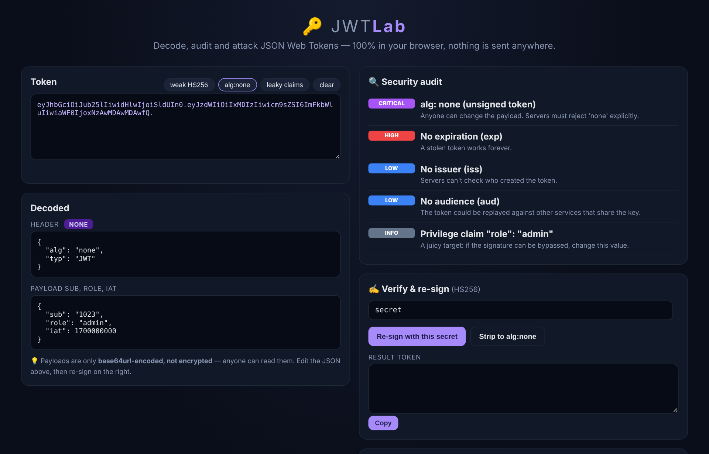
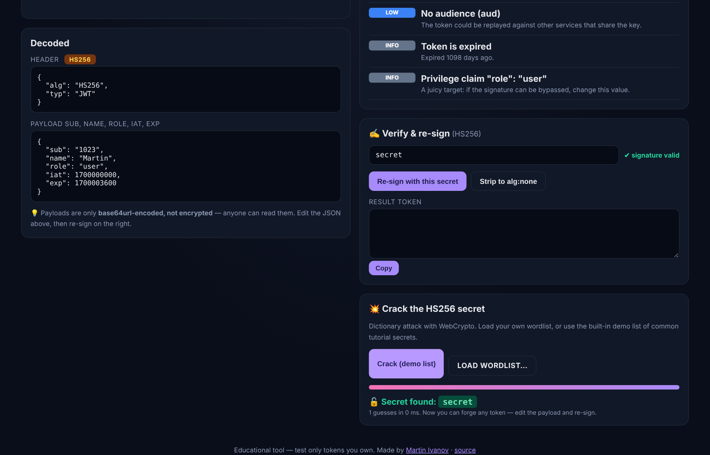
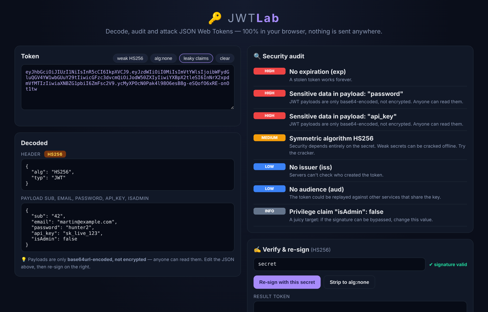

<div align="center">

# 🔑 JWT Lab

**Decode, audit and attack JSON Web Tokens — entirely in your browser. Nothing is ever sent to a server.**

### [▶ Open the lab](https://martun1.github.io/jwt-lab/)




</div>
> 🎥 **[Watch the demo video →](docs/demo.mp4)** (download to play)


---

## 📖 What is this?

JSON Web Tokens secure most modern APIs, and they're misused constantly. JWT Lab is an interactive
lab that teaches **JWT security** by letting you decode, audit and *attack* tokens hands-on. Everything
runs client-side with the browser's **WebCrypto API**, so you can safely paste real tokens: nothing
leaves your machine.

## ✨ Features

- 🔍 **Decode** header and payload live, with an editable JSON view
- 🛡️ **Security audit** of 15+ issues, each with severity and an explanation:
  - `alg: none` (unsigned tokens), empty signatures
  - dangerous headers: `jku` / `x5u` (key URLs), embedded `jwk`, `kid` injection
  - missing `exp`, overly long lifetimes, missing `iss` / `aud`
  - **sensitive data in the payload** (passwords, API keys) — a reminder that payloads aren't encrypted
  - privilege claims (`role`, `isAdmin`, `scope`) highlighted as attack targets
- ✍️ **Verify & re-sign** HS256 tokens with any secret
- 💥 **Crack weak HS256 secrets** with an in-browser dictionary attack (WebCrypto)
- 🎭 **Forge** tokens: strip to `alg:none` or re-sign after editing claims
- 📦 **Zero dependencies**, no build step, one static page

## 📸 Screenshots

<table>
<tr><td width="50%"><b>Cracking a weak secret, then forging an admin token</b><br></td>
<td width="50%"><b>Leaky payload (passwords & API keys in plain sight)</b><br></td></tr>
</table>

---

## 🚀 Tutorial — escalate from `user` to `admin`

### 1. Open the lab

- **Online:** [martun1.github.io/jwt-lab](https://martun1.github.io/jwt-lab/)
- **Offline:** clone and open `index.html` (no server needed)

```bash
git clone https://github.com/Martun1/jwt-lab.git
cd jwt-lab
```

### 2. Load the "weak HS256" sample

Click the **weak HS256** chip. You get a token with `"role": "user"`, signed with a weak secret.
The audit immediately flags the symmetric algorithm and the privilege claim.

### 3. Crack the secret

Click **Crack (demo list)**. The dictionary attack finds the secret (`secret`) in milliseconds, because
whoever set up the API never changed the tutorial default. The signature box turns green.

> In the real world you'd load a large wordlist with **Load wordlist…**. A strong, random 256-bit
> secret won't fall to this, which is exactly the point.

### 4. Forge an admin token

In the **Payload** box, change `"role": "user"` to `"role": "admin"`, then click **Re-sign with this
secret**. You now hold a *valid* token with elevated privileges. That's a full authentication bypass,
caused by one weak secret.

### 5. See the `alg:none` attack

Click the **alg:none** chip. This token has no signature at all. Servers that don't explicitly reject
`"alg": "none"` will trust whatever payload you send. Try **Strip to alg:none** on any token to see how
easily it's done.

---

## 🛡️ Defender's checklist

The lab teaches attacks so you can prevent them:

- ✅ **Pin the algorithm** server-side. Never trust the `alg` in the header. Reject `none`.
- ✅ Use a **long, random secret** for HS256 (32+ bytes), or better, **RS256/ES256** with asymmetric keys.
- ✅ Always set and **verify `exp`**, `iss` and `aud`.
- ✅ **Never put secrets in the payload** — it's encoded, not encrypted.
- ✅ Don't trust `jku`, `x5u`, `jwk` or `kid` from the token to locate verification keys.

## 🧠 How it works

HS256 signing is `HMAC-SHA256(base64url(header) + "." + base64url(payload), secret)`. JWT Lab does this
with the WebCrypto `SubtleCrypto` API:

```js
const key = await crypto.subtle.importKey("raw", enc.encode(secret),
              { name: "HMAC", hash: "SHA-256" }, false, ["sign"]);
const sig = await crypto.subtle.sign("HMAC", key, enc.encode(signingInput));
```

The cracker simply tries this for every word in a list and compares the result to the token's signature,
yielding to the UI between batches so the page stays responsive.

## 🧱 Project structure

```
jwt-lab/
├── index.html
├── style.css
├── js/jwt.js          # parse, sign, verify, forge, crack, audit (pure, also runs in Node)
├── js/wordlist.js     # small demo list of common tutorial secrets
├── js/app.js          # UI wiring
└── tests/jwt.test.js  # node --test (incl. the official jwt.io HS256 vector)
```

## 🧪 Tests

```bash
node --test tests/jwt.test.js
```

## 🗺️ Roadmap

- [ ] RS256 / ES256 verification with a pasted public key
- [ ] The RS256→HS256 key-confusion attack demo
- [ ] Timestamp claims rendered as human dates with a timeline

## ⚖️ Legal

For learning and for testing tokens **you own or are authorized to test**. Do not attack systems without permission.

---

<div align="center">
Made by <a href="https://github.com/Martun1">Martin Ivanov</a> · eJPT · CCNA · Computer Science @ NBU
</div>
